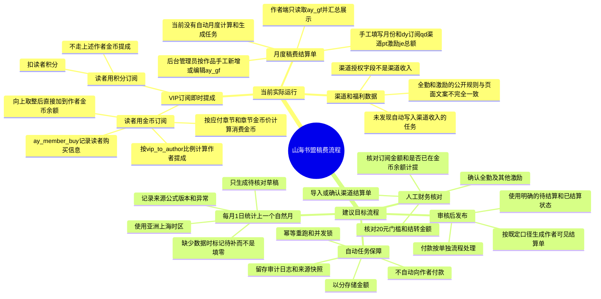

# 稿费流程与每月统计方案

> 用途：供项目负责人核对当前稿费流程和拟议的自动统计规则。  
> 状态：现状依据源码检查；方案待财务/业务负责人确认；本文档不代表功能已实现。  
> 更新日期：2026-11-21

## 稿费流程思维导图

## 源码确认的现状

### 1. VIP 订阅即时提成

订阅入口在 `include/pbcode.fun.php` 的 `dycontent()`。使用金币订阅时，程序根据应付章节数和章节金币价计算读者消费金币，再按 `vip_to_author` 比例计算作者提成，使用 `ceil()` 向上取整，并直接增加作品作者的 `ay_member.jinbi`。购买记录写入 `ay_member_buy`，其中的 `jz` 是读者消费值，不是专门记录的作者实际提成金额，也没有保存该笔交易采用的分成比例。

使用积分订阅时扣除读者积分，不走上述金币提成分支。因此，不能把全部订阅记录都当成作者人民币稿费，也不能用当前分成配置直接重算历史作者提成。若月度 `dy` 统计再次包含已即时计入作者金币余额的部分，还需要先决定如何避免重复计发。

源码位置：[dycontent()](include/pbcode.fun.php#L1836)，提成与余额更新在 [pbcode.fun.php](include/pbcode.fun.php#L1930)。

### 2. 月度结算单和作者端展示

后台 `SortController::gf()` 的新增、编辑逻辑只把表单中的 `yf`、`mc`、`je`、`dy`、`qd`、`pt` 和 `update_time` 写入 `ay_gf`，没有根据订阅、渠道或福利数据计算金额的代码。当前月度结算记录由管理员逐作品手工维护。

作者端 `author_gf_data()` 查询已有 `ay_gf` 记录，累计 `je` 作为稿费总额，并读取 `dy`、`qd`、`pt` 用于分项展示。代码没有校验 `je` 是否等于三个分项之和；作者端状态展示没有读取真实付款状态，而是由 `yf` 是否等于本月推断，非本月记录会被视为已结算，即使实际尚未付款。

源码位置：[后台稿费记录写入](apps/admin/controller/system/SortController.php#L2047)、[作者端稿费汇总](include/member/include/member.fun.php#L277)。

### 3. 规则文案与实际实现有差异

作者端规则文案写有“每月 1 号自动生成上月结算单”和“未满 20 元结转”，但没有相应任务或计算实现。网站说明写的是本站订阅与福利稿费每月 20 日结算上月、本站稿费满 20 元后发放；全勤在满足条件时于次月 1 日发放。

全勤规则在不同页面也不一致：网站说明包含月更字数和渠道费比例，作者福利页面则写日更字数、总稿费比例和断更天数。自动计算前需要负责人确认最终适用规则及数据来源。

参考：[作者端结算规则文案](include/member/include/member.fun.php#L432)、[网站稿费结算说明](jieshao.html#L408)。

## 建议的实现方案

### 目标边界

- 每月 1 日统计上一个自然月，产出可追溯、可审核的结算草稿。
- 统计任务不直接向作者转账、不直接修改作者金币余额。
- 财务审核通过后，才发布作者可见的结算记录；实际付款沿用独立付款流程。
- 网站说明当前写明本站稿费于每月 20 日结算，因此“1 日统计”和“20 日付款”应保持为两个不同动作，除非负责人另行确认政策变更。

### 数据与计算

1. `dy`：先确认统计口径和币种。现有购买记录可作为订阅活动的候选数据来源，但未记录历史作者提成金额和当时比例；必须防止把已经即时加入作者金币余额的提成再次计入待付金额。历史数据无法可靠还原的部分应标为待核，不应静默估算。
2. `qd`：渠道授权字段只说明作品是否授权，不代表渠道收入。应由经核验的渠道账单或财务确认数据提供；若没有接口或导入来源，保留人工录入/确认步骤。
3. `pt`：激励、全勤等项目需要统一最终规则。规则依赖的日更、字数、渠道数据或人工申请资料未齐时，草稿应标记待补/待核。
4. `je`：负责人确认总额定义后，再确定分项与总额的关系、舍入顺序和作者/作品级别。金额建议以整数分计算和存储，避免浮点误差。
5. 20 元门槛：若仍适用，按明确的“未付余额”结转，保留期初结转、本期新增、期末结转和可支付金额；不能仅凭 `ay_gf.yf` 推断是否已付款。

### 任务与审核

1. 通过服务器 CLI 定时任务运行 PHP 统计入口，建议时间为每月 1 日 01:05，服务器时区明确设置为 `Asia/Shanghai`。仓库内未发现该稿费任务配置；生产服务器是否另有面板计划任务，需要运维核实。
2. 任务固定统计上一个完整自然月，按作品和作者生成批次及明细，记录期间、来源摘要、金额分项、公式版本、生成时间和异常原因。
3. 草稿保存在独立的批次/明细台账中，设置月份唯一约束、运行锁和事务；同一月份重复运行不得重复发布。审核后的数据不可被静默覆盖，调整应留下更正记录。
4. 财务核对订阅来源、渠道账单、激励资格、结转金额及合计后人工批准发布。若作者端需要显示付款状态，应使用明确状态来源，不能继续按月份猜测。
5. 任一必要来源缺失、金额对不上或政策规则未确认时，任务保留草稿并标记异常，不生成可付款金额，也不自动打款。

### 上线验收

- 在隔离数据库中用已核对的历史月份试算，与人工结算清单逐作品对账。
- 验证跨年/月末、闰年、同月重复执行、并发执行、低于 20 元结转、费率变化、积分/金币订阅区分、缺失渠道数据和激励待核等情形。
- 对已批准批次验证发布幂等、作者归属、分项合计、状态展示和审计记录。
- 第一阶段只启用草稿生成和人工核对；对账通过并经负责人确认后，再启用正式发布。自动付款不属于本方案。

## 请项目负责人确认

- [ ] 每月 1 日生成上月统计草稿；是否确认与每月 20 日付款分开？
- [ ] `dy` 的统计币种、订阅数据口径，以及已入作者金币余额的提成如何避免重复计算？
- [ ] 渠道收入 `qd` 的权威账单来源和导入/确认责任人是什么？
- [ ] 全勤、创作激励等 `pt` 项目最终采用哪份规则，哪些数据需人工审核？
- [ ] 20 元门槛、结转范围、结转单位（作品或作者）和付款状态如何定义？
- [ ] `je` 与 `dy + qd + pt` 是否必须相等；各项按何种顺序舍入？
- [ ] 是否同意新增独立草稿/审核台账，并在批准后接入现有作者端结算清单？

## 代码变更边界

仓库的[开发前置要求](开发前置要求.md#L39)目前把 `SortController::gf()`、`ay_gf`、作者端稿费读取/计算及其状态流转列为保护范围，并明确禁止改动相关业务 SQL。本文档只供方案审阅；实施前需要负责人确认财务口径，并明确允许改动的代码和数据库范围。当前方案不授权自动付款或历史金额重算。
